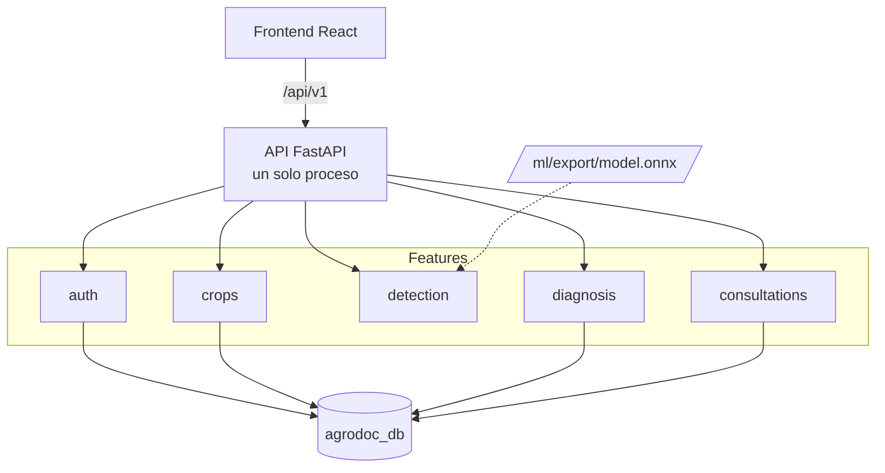

# AgroDoc - Plataforma de Diagnóstico Agrícola

AgroDoc es un ecosistema digital para el monitoreo agrícola y el diagnóstico temprano de plagas mediante Inteligencia Artificial. El usuario sube una foto de su cultivo, el sistema detecta la plaga y entrega un diagnóstico básico; si la confianza del modelo es baja, el caso se envía a un agrónomo para que lo revise. Además permite guardar y dar seguimiento a los cultivos.

Este repositorio es un **monorepo** con un **monolito modular y vertical slicing**: un solo backend FastAPI organizado por módulos (features), un frontend React y un único Postgres, orquestados con Docker Compose.

> **Estado actual:** la estructura, el entorno Docker y la base de datos están listos. El API expone `/health` y un health por módulo; la lógica de negocio se irá agregando módulo por módulo.

## 👥 Equipo y roles

* **Frontend:** Diego Galvez
* **Backend:** Hogla Calix y María Fernanda Rodríguez
* **Entrenamiento IA / Docker:** Alejandro Villanueva

## 🏗 Arquitectura



* **Un solo desplegable de backend.** No hay gateway ni llamadas HTTP entre módulos: se llaman funciones de `service.py` en el mismo proceso.
* **Una sola base de datos** (`agrodoc_db`). Cada tabla tiene un módulo dueño.
* **Vertical slicing:** cada carpeta de `Backend/app/features/` contiene sus endpoints, su lógica y sus tablas.

El detalle de las reglas y del porqué de la decisión está en [`docs/arquitectura.md`](docs/arquitectura.md); el diseño de tablas, en [`docs/base-de-datos.md`](docs/base-de-datos.md).

### Módulos

| Módulo | Responsabilidad | Tablas |
|---|---|---|
| `auth` | Usuarios, login, sesiones y roles (agricultor / agrónomo) | `users`, `agronomist_profiles`, `refresh_tokens` |
| `crops` | Fincas, cultivos guardados y su historial | `crop_types`, `farms`, `crops`, `crop_events` |
| `detection` | Inferencia del modelo: imagen → plaga + confianza | — (carga `ml/export/model.onnx`) |
| `diagnosis` | Convierte la detección en diagnóstico y recomendaciones | `pests`, `pest_crops`, `treatments`, `diagnoses` |
| `consultations` | Casos enviados a agrónomos cuando la confianza es baja | `consultations`, `consultation_messages` |

### Reglas de dependencia

1. Nadie importa el `router.py` de otro módulo (salvo `app/main.py` para montarlo).
2. Nadie importa `models.py` ni `repository.py` de otro módulo. Si necesitas datos, usa su `service.py`.
3. `core/` y `shared/` no conocen a los módulos.
4. Entre módulos no hay HTTP: son llamadas directas dentro del proceso.

## 📁 Estructura del repositorio

```
AgroDoc/
├── Backend/                 # monolito FastAPI
│   ├── app/
│   │   ├── main.py          # crea la app y monta los routers
│   │   ├── core/            # config, base de datos, seguridad, errores
│   │   ├── shared/          # kernel mínimo compartido
│   │   └── features/        # ← vertical slices
│   │       ├── auth/
│   │       ├── crops/
│   │       ├── detection/
│   │       ├── diagnosis/
│   │       └── consultations/
│   ├── alembic/             # una sola historia de migraciones
│   ├── tests/
│   ├── Dockerfile
│   ├── requirements.txt
│   └── requirements-dev.txt
├── Frontend/                # React + Vite (JavaScript), gestionado con pnpm
├── ml/                      # Entrenamiento del modelo (no se despliega)
│   ├── notebooks/           # Exploración y experimentos
│   ├── training/            # Scripts de entrenamiento / fine-tuning
│   ├── export/              # Modelo exportado (ONNX) que usa `detection`
│   └── datasets/            # Datos (NO se suben a git)
├── infra/
│   ├── docker-compose.yml       # API + Postgres + frontend
│   ├── docker-compose.dev.yml   # Override de desarrollo (recarga en caliente)
│   └── nginx/                   # Reservada para configuración de nginx
├── docs/                    # Arquitectura, base de datos y contrato OpenAPI
├── scripts/                 # Scripts bash para el día a día (ver abajo)
├── .env.example             # Plantilla de variables de entorno
└── README.md
```

### Estructura interna de un módulo

```
Backend/app/features/<modulo>/
├── __init__.py
├── router.py       # endpoints HTTP
├── service.py      # casos de uso (API pública del módulo)
├── models.py       # tablas SQLAlchemy (si tiene base de datos)
├── schemas.py      # esquemas Pydantic (cuando haga falta)
└── repository.py   # consultas a la base (cuando haga falta)
```

`detection` no tiene `models.py` ni `repository.py` porque no guarda datos. `schemas.py` y `repository.py` se crean solo cuando el módulo los necesita.

## ✅ Requisitos

* [Docker](https://docs.docker.com/engine/install/) con Docker Compose v2 (`docker compose`)
* Git
* `curl` (lo usa `scripts/status.sh`)
* Opcional, para trabajar fuera de Docker:
  * Node.js 22+ y pnpm (`corepack enable`) para el frontend
  * Python 3.12 para el backend

## 🚀 Inicio rápido

```bash
git clone https://github.com/maferodri/AgroDoc.git
cd AgroDoc
chmod +x scripts/*.sh      # solo la primera vez
./scripts/dev.sh           # construye y levanta todo
./scripts/migrate.sh       # aplica las migraciones (cuando existan)
./scripts/status.sh        # comprueba que todo responda
```

Si todo está bien, verás un ✔ por el API, por cada módulo y por el frontend. Podrás abrir:

* Web: http://localhost:3000
* API: http://localhost:8000/health
* Swagger (todos los módulos): http://localhost:8000/docs
* Health por módulo: `http://localhost:8000/api/v1/<modulo>/health` (por ejemplo http://localhost:8000/api/v1/auth/health)

La primera vez tarda unos minutos porque descarga imágenes y construye el entorno. El script crea el archivo `.env` automáticamente a partir de `.env.example` si no existe.

## 🛠 Scripts

Todos se ejecutan desde cualquier carpeta del repo, por ejemplo `./scripts/dev.sh`.

| Script | Qué hace |
|---|---|
| `scripts/dev.sh [servicio...]` | Levanta el entorno de desarrollo. Sin argumentos levanta todo. |
| `scripts/down.sh` | Apaga y elimina los contenedores (los datos de Postgres se conservan). |
| `scripts/status.sh` | Lista los contenedores y comprueba el API, cada módulo y la web. |
| `scripts/logs.sh [servicio]` | Sigue los logs en vivo. Ejemplo: `./scripts/logs.sh api`. |
| `scripts/rebuild.sh <servicio>` | Reconstruye un servicio. Úsalo si cambias `requirements.txt`, `package.json` o un Dockerfile. |
| `scripts/migrate.sh` | Aplica las migraciones de Alembic. Con `-m "mensaje"` genera una revisión autogenerada. |
| `scripts/reset-db.sh` | **Borra** los datos de Postgres y recrea la base desde cero (pide confirmación). |

## 💻 Flujo de trabajo por rol

### Backend (FastAPI)

En desarrollo, el código de `Backend/` está montado dentro del contenedor y uvicorn corre con `--reload`: al guardar un archivo en `Backend/app/`, el API se recarga solo. Si un módulo tiene un error de importación, el proceso completo no arranca (es un monolito): revisa `./scripts/logs.sh api`.

* **Implementar un endpoint:** agrégalo en `features/<modulo>/router.py` y la lógica en `features/<modulo>/service.py`. El contrato está en [`docs/openapi.yaml`](docs/openapi.yaml).
* **Agregar una dependencia:** añádela a `Backend/requirements.txt` y ejecuta `./scripts/rebuild.sh api`.
* **Ver errores:** `./scripts/logs.sh api`.
* **Probar el API:** http://localhost:8000/docs (Swagger) o http://localhost:8000/api/v1/<modulo>/health.
* **Variables de entorno:** el API recibe `DATABASE_URL`, `JWT_SECRET`, `CORS_ORIGINS`, `MODEL_PATH` y `CONFIDENCE_THRESHOLD` desde `infra/docker-compose.yml`. Si necesitas una nueva, agrégala en `app/core/config.py` y en el compose.
* **Entrar a la base de datos:**

  ```bash
  docker compose -f infra/docker-compose.yml --env-file .env exec postgres psql -U agrodoc -d agrodoc_db
  ```

  (el usuario es el valor de `POSTGRES_USER` en tu `.env`).
* **Migraciones:**

  ```bash
  ./scripts/migrate.sh                       # aplica todo
  ./scripts/migrate.sh -m "crear users"      # autogenera una revisión
  ```

  Revisa siempre el archivo generado en `Backend/alembic/versions/` antes de aplicarlo.
* **Tests:**

  ```bash
  cd Backend
  python -m venv .venv && source .venv/bin/activate
  pip install -r requirements-dev.txt
  pytest
  ```
* **Trabajar sin Docker (opcional):**

  ```bash
  cd Backend
  python -m venv .venv && source .venv/bin/activate
  pip install -r requirements.txt
  uvicorn app.main:app --reload --port 8000
  ```

### Frontend (React)

El contenedor `web` sirve el build de producción, sin recarga en caliente. Para desarrollar conviene correr Vite en local:

```bash
cd Frontend
corepack enable          # una sola vez, activa pnpm
pnpm install
pnpm dev                 # http://localhost:5173
```

Otros comandos: `pnpm build` (compilar) y `pnpm lint` (oxlint).

La API se consume en `http://localhost:8000/api/v1`. El API ya permite CORS para `http://localhost:5173` y `http://localhost:3000`.

> Este proyecto usa **pnpm**. No uses `npm install` ni `yarn`: generan otro lockfile y rompen el build de Docker (`--frozen-lockfile`).

### IA / Modelo

* El entrenamiento y los experimentos viven en `ml/` y **no** forman parte de las imágenes de Docker.
* El módulo `detection` carga el modelo desde `ml/export/model.onnx` (montado como volumen en `/models`, variable `MODEL_PATH`). Para probar un modelo nuevo basta con reemplazar ese archivo y reiniciar el API: `./scripts/rebuild.sh api`.
* Los datasets (`ml/datasets/`) y los modelos (`*.onnx`, `*.pt`) están en el `.gitignore` y **no se suben al repositorio**. Hay que compartirlos por otro medio (Drive, release, etc.).

## 🗄 Base de datos

Hay un único servidor Postgres con una base, `agrodoc_db`, que se crea automáticamente al iniciar el contenedor (`POSTGRES_DB`). El esquema se gestiona con Alembic; el diseño de referencia está en [`docs/base-de-datos.md`](docs/base-de-datos.md).

* Postgres no se publica en tu máquina; solo el API lo ve por la red interna.
* Los datos se guardan en el volumen `agrodoc_pgdata`, así que sobreviven a `./scripts/down.sh`.
* Si cambias el esquema: `./scripts/migrate.sh -m "mensaje"` y luego `./scripts/migrate.sh`.
* Para empezar de cero con la base vacía: `./scripts/reset-db.sh` y después `./scripts/migrate.sh`.

## ➕ Agregar un módulo nuevo

1. Crea `Backend/app/features/<nuevo>/` con `__init__.py`, `router.py` y `service.py`.
2. Si tiene tablas, agrega `models.py` (y `repository.py` si hace falta) y define ahí sus tablas.
3. Importa sus modelos en `Backend/alembic/env.py` para que `--autogenerate` los detecte.
4. Monta su router en `Backend/app/main.py` (`ROUTERS`).
5. Añádelo a `API_MODULES` en `scripts/_common.sh`.
6. Documenta sus endpoints en `docs/openapi.yaml`.

No hay que tocar puertos, contenedores ni variables de entorno entre servicios.

## 📏 Convenciones

* **Frontend:** React con JavaScript, linter **oxlint**, gestor **pnpm** (versión fijada en `packageManager`).
* **Backend:** un directorio por módulo en `app/features/`; sin acceso cruzado a tablas ni a modelos.
* **Secretos:** nunca subas `.env`. Las plantillas van en `.env.example`.
* **Dependencias:** nunca commitees `node_modules`, `.venv`, datasets ni modelos.
* **Git:** se recomienda trabajar en ramas por funcionalidad (`feature/<area>-<descripcion>`) y hacer pull request hacia `main`, en lugar de commitear directo.

## 🩹 Problemas comunes

* **El puerto ya está en uso:** algo más usa 3000 u 8000. Detenlo o cambia el puerto en `infra/docker-compose.yml`.
* **El API no responde:** `./scripts/logs.sh api` muestra el error de importación o de conexión. Si cambiaste dependencias, usa `./scripts/rebuild.sh api`.
* **Cambié `.env` y no se aplica:** reinicia con `./scripts/down.sh` y luego `./scripts/dev.sh`.
* **`Permission denied` en los volúmenes (Fedora/SELinux):** agrega `:z` al final de los volúmenes montados en `infra/docker-compose.dev.yml` (por ejemplo `"../Backend:/code:z"`).
* **Alembic no ve mis tablas:** revisa que el `models.py` del módulo esté importado en `Backend/alembic/env.py`.
* **Vengo de la versión de microservicios:** el volumen viejo conserva `auth_db`, `crops_db`, etc., pero no `agrodoc_db`. Ejecuta `./scripts/reset-db.sh` (borra los datos) o crea la base a mano y aplica las migraciones.
* **Quiero empezar de cero:** `./scripts/down.sh`, y si también quieres borrar los datos, `./scripts/reset-db.sh`.

## 🗺 Próximos pasos

- [ ] `auth`: registro, login (JWT) y roles
- [ ] Modelos SQLAlchemy y migración inicial de cada módulo
- [ ] `crops`: CRUD de cultivos e historial
- [ ] `detection`: carga del modelo ONNX y función de inferencia
- [ ] `diagnosis` y `consultations`: flujo de baja confianza hacia agrónomos
- [ ] Guardianes de autenticación reutilizables (`Depends`) en `app/core`
- [ ] Linter y formateador para Python (por ejemplo Ruff)
