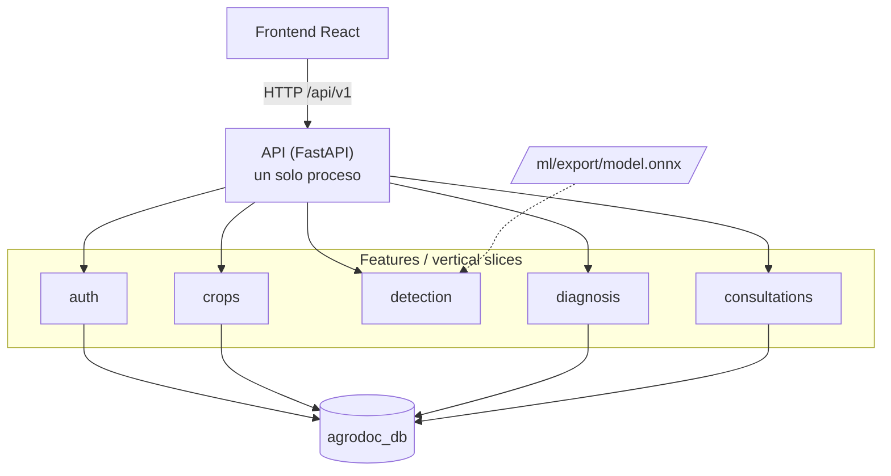
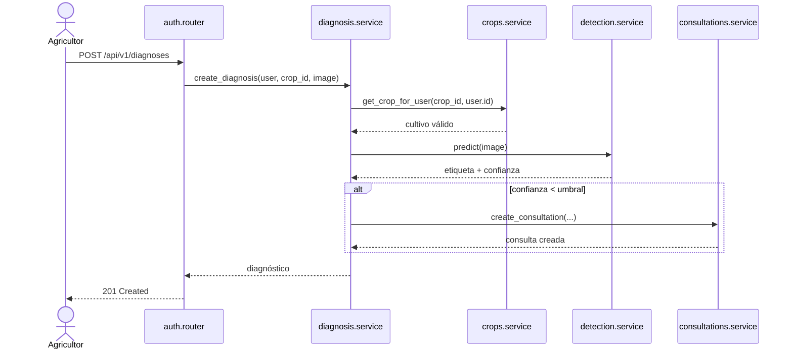

# Arquitectura de AgroDoc

## 1. Decisión

AgroDoc es un **monolito modular con vertical slicing**:

* **Un solo desplegable**: un proceso FastAPI (`Backend/`) y un build de React (`Frontend/`).
* **Un solo servidor de base de datos** con una única base, `agrodoc_db`.
* **Módulos por funcionalidad** (*slices* verticales): cada módulo contiene sus endpoints, su lógica, sus esquemas y sus tablas.



Los módulos se llaman **en proceso** (importando funciones de `service.py`), no por HTTP. `detection` no tiene tablas: solo hace inferencia.

## 2. Qué cambió respecto a los microservicios

| Antes (microservicios) | Ahora (monolito modular) |
|---|---|
| 6 servicios FastAPI + 1 gateway | 1 API con 5 módulos |
| 6 contenedores de backend, 6 Dockerfiles | 1 contenedor `api`, 1 Dockerfile |
| 4 bases (`auth_db`, `crops_db`, …) | 1 base (`agrodoc_db`) |
| Comunicación por HTTP (`http://auth:8000`) | Llamadas directas a `service.py` |
| Un `alembic/` por servicio | Un `alembic/` en `Backend/` |
| Gateway que enruta y valida token | FastAPI monta los routers y las dependencias de auth |
| Puertos 8000–8005 | Puerto 8000 |

## 3. Estructura del backend

```
Backend/
├── app/
│   ├── main.py                  # crea la app y monta todos los routers
│   ├── core/                    # infraestructura transversal
│   │   ├── config.py            # settings (env vars)
│   │   ├── database.py          # engine, sesión, Base de SQLAlchemy
│   │   ├── security.py          # hash de contraseñas y JWT
│   │   └── exceptions.py        # errores de dominio → HTTP
│   ├── shared/
│   │   └── schemas.py           # esquemas de uso común
│   └── features/                # ← un directorio por módulo (vertical slicing)
│       ├── auth/
│       │   ├── router.py        # endpoints
│       │   ├── service.py       # casos de uso (API pública del módulo)
│       │   ├── models.py        # tablas que posee el módulo
│       │   ├── schemas.py       # entrada/salida (cuando exista)
│       │   └── repository.py    # consultas a la base (cuando exista)
│       ├── crops/
│       ├── detection/           # sin models.py ni repository.py: no tiene BD
│       ├── diagnosis/
│       └── consultations/
├── alembic/                     # una sola historia de migraciones
├── tests/
├── Dockerfile
├── requirements.txt
└── requirements-dev.txt
```

Los archivos `schemas.py` y `repository.py` se crean **cuando el módulo los necesita**. No hace falta crearlos vacíos para todos.

## 4. Anatomía de un slice

Cada módulo expone una única API pública hacia los demás: las funciones de su `service.py`.

| Archivo | Responsabilidad | Quién lo importa |
|---|---|---|
| `router.py` | Valida HTTP, llama al servicio y devuelve la respuesta | Solo `app/main.py` |
| `service.py` | Reglas de negocio y casos de uso | Su `router.py` y otros `service.py` |
| `repository.py` | Acceso a la base de datos | Solo su `service.py` |
| `models.py` | Tablas SQLAlchemy del módulo | Su `repository.py` y `alembic/env.py` |
| `schemas.py` | Pydantic de entrada/salida | Su `router.py` y su `service.py` |

### Reglas de dependencia

1. **Nadie importa el `router.py` de otro módulo** (salvo `main.py` para montarlo).
2. **Nadie importa `models.py` ni `repository.py` de otro módulo.** Si necesitas datos, usa su `service.py`.
3. **Nadie importa modelos de otro módulo en una consulta.** Si `diagnosis` necesita validar un cultivo, llama a `crops.service`.
4. **`core/` y `shared/` no conocen a los módulos.** Ningún archivo de `core/` importa `features/`.
5. **No hay ciclos.** Si dos módulos se necesitan mutuamente, uno de los dos debe exponer una función de bajo nivel y el otro consumirla, o se extrae el concepto compartido a `shared/`.

Lo que **sí** está permitido: `diagnosis.service` importando `crops.service`, `detection.service` y `consultations.service`. Es una llamada de función normal, sin red ni serialización.

## 5. Cómo se comunican los módulos

Ejemplo del flujo de un diagnóstico con confianza baja:



Todo ocurre en el mismo proceso y en la misma transacción lógica. Ya no hay `httpx` entre módulos ni URLs internas en variables de entorno.

## 6. Base de datos

* Una base: `agrodoc_db`.
* Cada tabla tiene **un módulo dueño**: solo ese módulo la lee y escribe.
* Las referencias **dentro de un módulo** son `FOREIGN KEY` reales.
* Las referencias **entre módulos** se guardan como `uuid` sin FK (referencia lógica) y se validan llamando al `service.py` del otro módulo.
* Alembic es la fuente de verdad del esquema (`./scripts/migrate.sh`).

El detalle de tablas y relaciones está en [`base-de-datos.md`](./base-de-datos.md).

## 7. Agregar un módulo nuevo

1. Crea `app/features/<nombre>/` con `__init__.py`, `router.py` y `service.py`.
2. Añade `models.py` (y `repository.py` si hace falta) solo si el módulo tiene tablas.
3. Importa sus modelos en `alembic/env.py` para que `--autogenerate` los detecte.
4. Monta su router en `app/main.py` (`ROUTERS`).
5. Agrégalo a `API_MODULES` en `scripts/_common.sh` para que `status.sh` lo compruebe.
6. Documenta sus endpoints en `docs/openapi.yaml`.

No hay que tocar Docker, ni puertos, ni variables de entorno entre servicios.

## 8. Ventajas y trade-offs

| A favor | En contra |
|---|---|
| Menos infraestructura: 1 API + 1 Postgres + 1 frontend | Escala como una unidad: no puedes escalar solo `detection` |
| Refactor y depuración en un solo proceso | Un fallo de importación tumba toda la app |
| Transacciones y llamadas directas, sin latencia de red | Riesgo de acoplar módulos si no se respetan las reglas |
| Un solo `docker compose`, un solo despliegue | Un solo pipeline de build |
| Un solo historial de migraciones | Las migraciones tocan varios módulos a la vez |

El objetivo del vertical slicing es conservar la **modularidad** de los microservicios sin pagar su **costo operativo**. Si en el futuro un módulo necesita escalar por separado (por ejemplo `detection` por el uso de CPU/GPU), se puede extraer a un servicio sin reescribir su lógica: su `service.py` ya tiene el límite definido.
