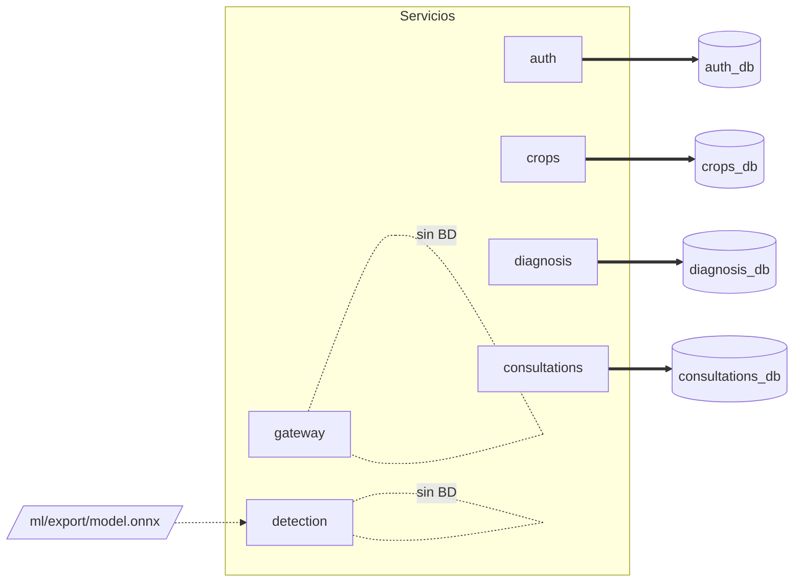
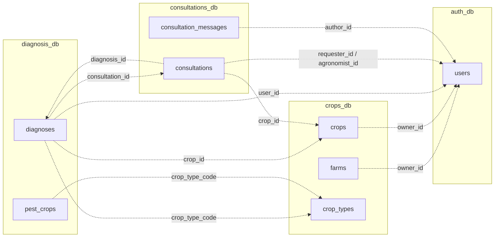
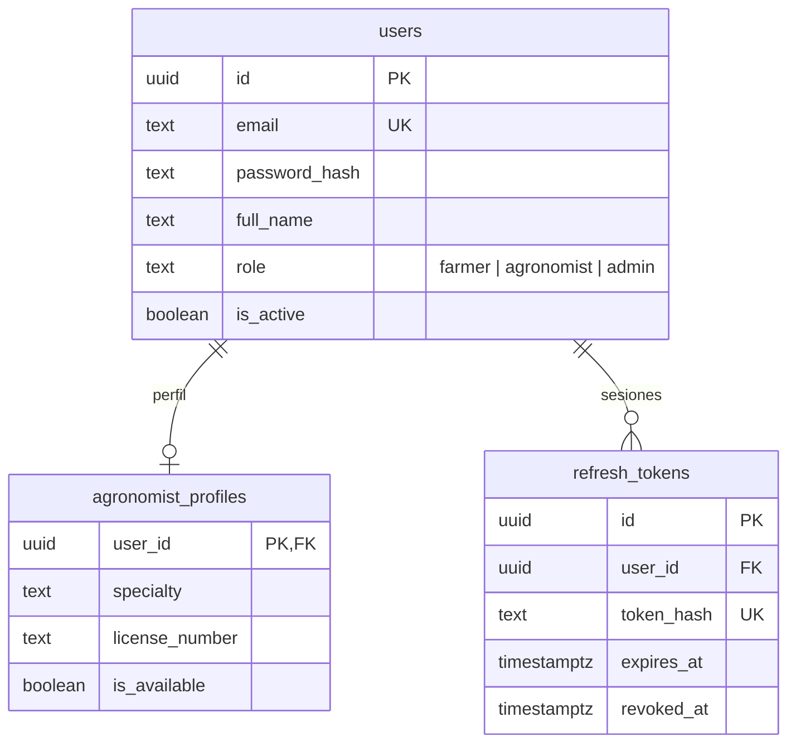
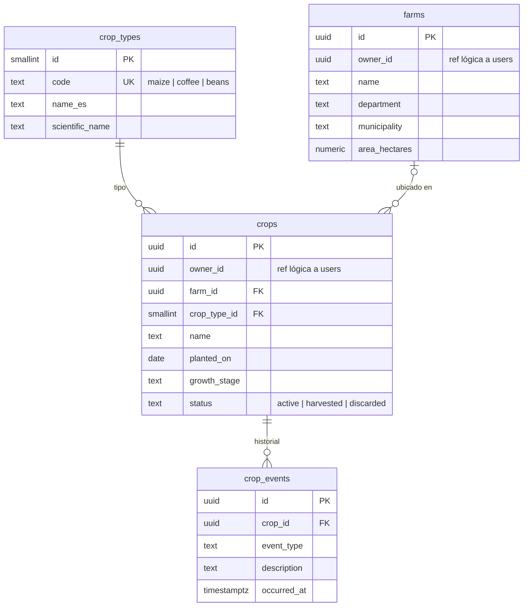
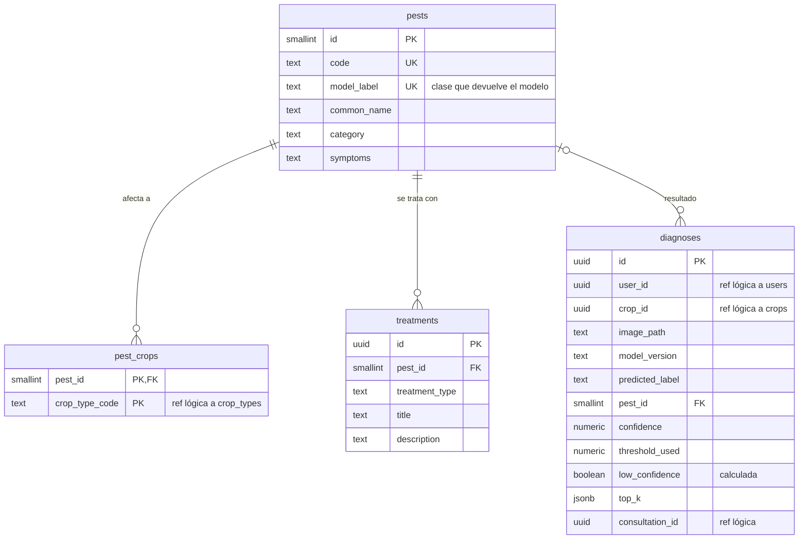
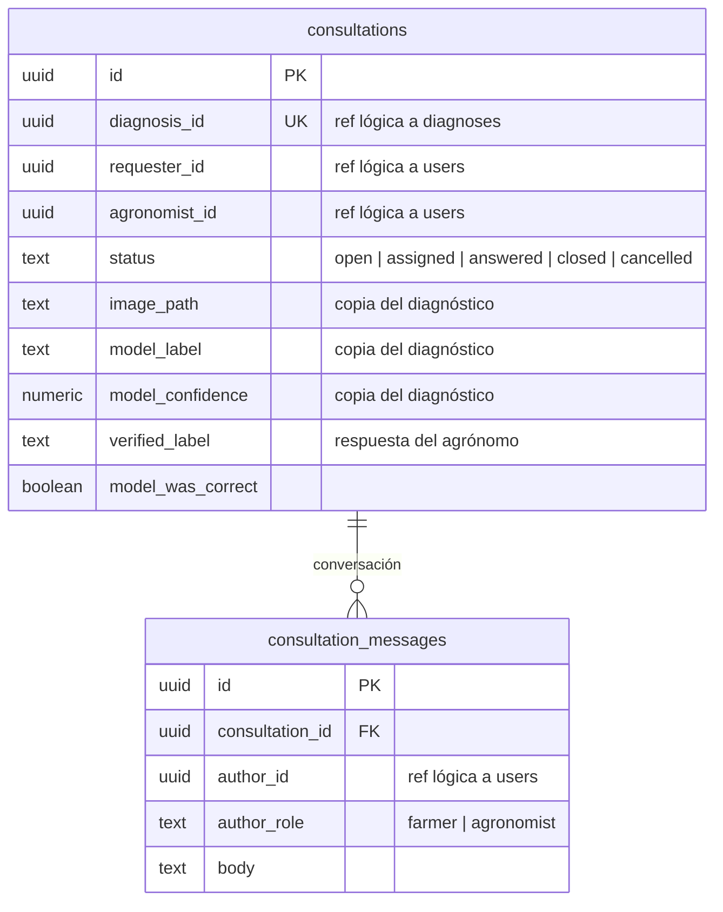
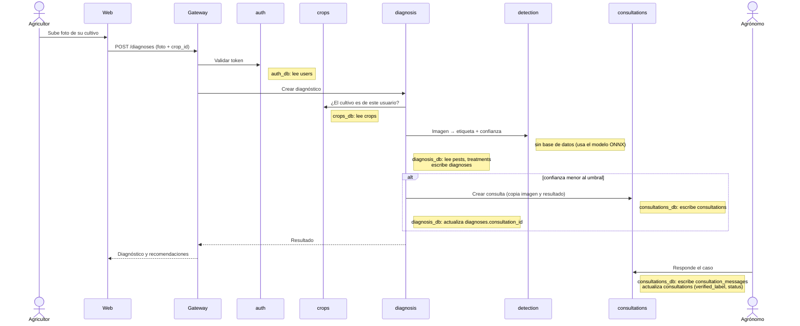

# Base de datos de AgroDoc

Documento de diseño de Postgres: qué bases existen, qué tablas tiene cada una, **qué servicio es dueño de cada tabla** y cómo se relacionan entre sí.

Los esquemas SQL están en [`infra/postgres/schema/`](../infra/postgres/schema/) (uno por base de datos) y se aplican con `./scripts/schema.sh`.

## 1. ¿Una base o varias?

**Decisión: un servidor Postgres con una base de datos por servicio** (`auth_db`, `crops_db`, `diagnosis_db`, `consultations_db`). Es lo que ya crea `infra/postgres/init-databases.sh`.

| | Una base por servicio (elegida) | Una sola base compartida |
|---|---|---|
| Independencia | Cada servicio cambia su esquema sin afectar a los demás | Un cambio de tabla puede romper a otro servicio |
| Acoplamiento | Obliga a comunicarse por API | Tentación de hacer `JOIN` entre servicios (monolito disfrazado) |
| Integridad | Sin `FOREIGN KEY` entre servicios; se valida por API | `FOREIGN KEY` en todo |
| Complejidad | Algo más de trabajo al cruzar datos | Más simple de consultar |

`detection` y `gateway` **no tienen base de datos**: `detection` solo hace inferencia y `gateway` solo enruta.

> Si el equipo prefiere simplificar, existe un término medio: una sola base con un *schema* por servicio y un usuario de Postgres por servicio con permiso solo sobre su schema. Para el alcance de la clase, lo ya montado (una base por servicio) cumple mejor la idea de microservicios.

## 2. Reglas

1. **Cada tabla tiene un solo servicio dueño.** Solo ese servicio la lee y escribe directamente.
2. **Prohibido consultar la base de otro servicio.** Si `diagnosis` necesita saber si un cultivo es del usuario, se lo pregunta a `crops` por HTTP.
3. **Referencias entre servicios = columnas `uuid` sin `FOREIGN KEY`** (en los `.sql` están marcadas como `ref lógica`). Por ejemplo, `crops.owner_id` guarda un `users.id`, pero Postgres no lo verifica.
4. **IDs `uuid`** generados por la base (`gen_random_uuid()`), así se pueden compartir entre servicios sin colisiones. Los catálogos pequeños usan `smallserial` más un `code` estable.
5. **Fechas en `timestamptz`** y `updated_at` automático mediante trigger.
6. **No se borran usuarios**: se desactivan (`users.is_active = false`), porque otros servicios guardan su `id`.

## 3. Vista general: qué servicio usa qué base



Las flechas gruesas son acceso directo (lectura y escritura). Todo lo demás pasa por API.

## 4. Referencias lógicas entre bases

Cada flecha punteada es una columna `uuid` que apunta a otra base **sin** `FOREIGN KEY`:



## 5. Diagramas por base de datos

### auth_db (servicio `auth`)



### crops_db (servicio `crops`)



### diagnosis_db (servicio `diagnosis`)



### consultations_db (servicio `consultations`)



## 6. Quién usa cada tabla

**Dueño** = único servicio que la lee y escribe en la base. **Consumidores** = servicios que necesitan sus datos y los obtienen **por API** del dueño.

| Base | Tabla | Dueño | Consumidores (vía API) | Para qué |
|---|---|---|---|---|
| `auth_db` | `users` | `auth` | `gateway` (validar sesión), `consultations` (nombre del agrónomo) | Cuentas y roles |
| `auth_db` | `agronomist_profiles` | `auth` | `consultations` (elegir agrónomo disponible) | Datos del agrónomo |
| `auth_db` | `refresh_tokens` | `auth` | — | Renovar sesión |
| `crops_db` | `crop_types` | `crops` | `diagnosis`, `web` | Catálogo: maíz, café, frijol |
| `crops_db` | `farms` | `crops` | `web` | Fincas del usuario |
| `crops_db` | `crops` | `crops` | `diagnosis` (verificar que el cultivo es del usuario), `consultations` (contexto del caso), `web` | Cultivos guardados |
| `crops_db` | `crop_events` | `crops` | `web` | Bitácora del cultivo |
| `diagnosis_db` | `pests` | `diagnosis` | `consultations`, `web` | Catálogo de plagas |
| `diagnosis_db` | `pest_crops` | `diagnosis` | `web` | Qué plaga afecta a qué cultivo |
| `diagnosis_db` | `treatments` | `diagnosis` | `web` | Recomendaciones por plaga |
| `diagnosis_db` | `diagnoses` | `diagnosis` | `crops` (historial de un cultivo), `consultations` (detalle del caso), `web` | Resultado de cada imagen analizada |
| `consultations_db` | `consultations` | `consultations` | `diagnosis` (estado del caso), `web` | Casos escalados a agrónomos |
| `consultations_db` | `consultation_messages` | `consultations` | `web` | Conversación agricultor ↔ agrónomo |
| *(sin BD)* | — | `detection`, `gateway` | — | Inferencia y enrutado |

## 7. Qué tablas se tocan en cada paso

Flujo de un diagnóstico con baja confianza:



## 8. Detalles de diseño

* **`diagnoses.low_confidence` es una columna calculada** (`confidence < threshold_used`), así nunca se contradice con la confianza guardada. El umbral se configura en el servicio `diagnosis` (variable de entorno) y se guarda en cada fila para saber con cuál se decidió.
* **`diagnoses.top_k`** guarda las mejores predicciones alternativas del modelo en JSON: `[{"label": "...", "confidence": 0.12}]`.
* **`consultations` guarda una copia** de la imagen, la etiqueta y la confianza del modelo. Así el agrónomo ve el caso completo sin que `consultations` dependa de `diagnosis` en cada lectura.
* **Reentrenamiento:** cuando el agrónomo responde, `verified_label` y `model_was_correct` quedan como etiqueta verificada por un experto. Es una fuente de datos reales de la región para el fine-tuning del modelo.
* **`pests.model_label`** es la clase exacta que devuelve el modelo. Tiene que coincidir con la lista de clases del entrenamiento (`ml/`); si se agregan o renombran clases, hay que actualizar el catálogo.
* **`crop_types.code`** (`maize`, `coffee`, `beans`) es la clave estable que usan los demás servicios en vez del `id` numérico.

## 9. Pendientes y decisiones abiertas

- [ ] **Almacenamiento de imágenes:** las tablas guardan `image_path`, pero aún no hay dónde se guardan los archivos (un volumen de Docker compartido, MinIO/S3, etc.). Hay que decidirlo y agregarlo al compose.
- [ ] **Datos iniciales (seed):** `crop_types` ya viene con maíz, café y frijol; `pests`, `pest_crops` y `treatments` están vacías y deben llenarse con las plagas del modelo y sus tratamientos, idealmente revisados por un agrónomo.
- [ ] **Alembic:** estos `.sql` son el diseño de referencia. Cuando el equipo de backend cree los modelos SQLAlchemy, las migraciones de Alembic pasan a ser la fuente de verdad. Mientras tanto, `./scripts/schema.sh` sirve para probar.
- [ ] **URLs entre servicios en el compose:** en el diagrama del punto 7, `diagnosis` llama a `crops` y a `consultations`, pero en `infra/docker-compose.yml` solo tiene `DETECTION_URL`. Hay que agregarle `CROPS_URL` y `CONSULTATIONS_URL`.
- [ ] **Umbral de confianza:** definir el valor inicial (por ejemplo 0.70) y dónde se configura.

## 10. Cómo aplicar y revisar los esquemas

Con el entorno levantado (`./scripts/dev.sh`):

```bash
./scripts/schema.sh                # aplica los cuatro esquemas
./scripts/schema.sh crops          # solo uno
```

Los scripts son idempotentes: se pueden correr varias veces. Para ver las tablas de una base:

```bash
docker compose -f infra/docker-compose.yml --env-file .env exec postgres \
  psql -U agrodoc -d crops_db -c '\dt'
```

(cambia `agrodoc` por el valor de `POSTGRES_USER` en tu `.env`, y `crops_db` por la base que quieras ver).

Para empezar de cero con las bases vacías: `./scripts/reset-db.sh`.
