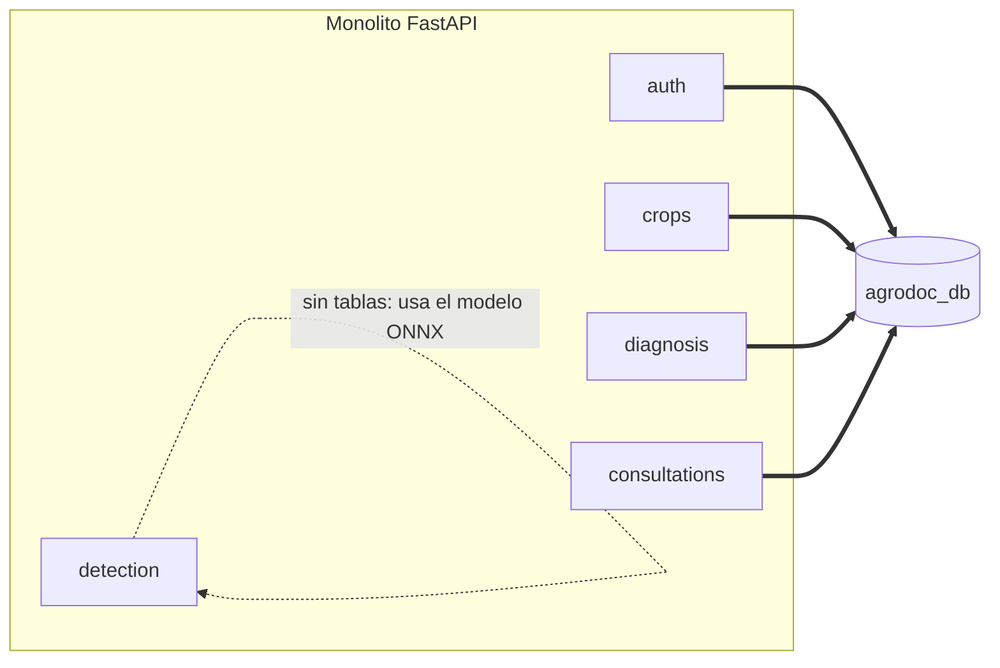
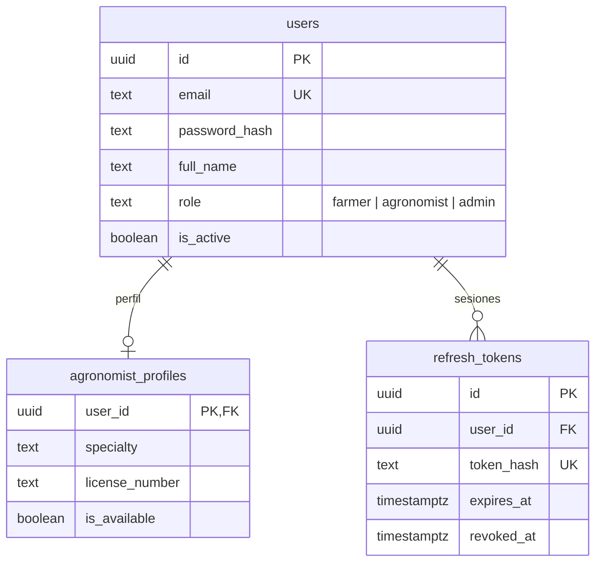
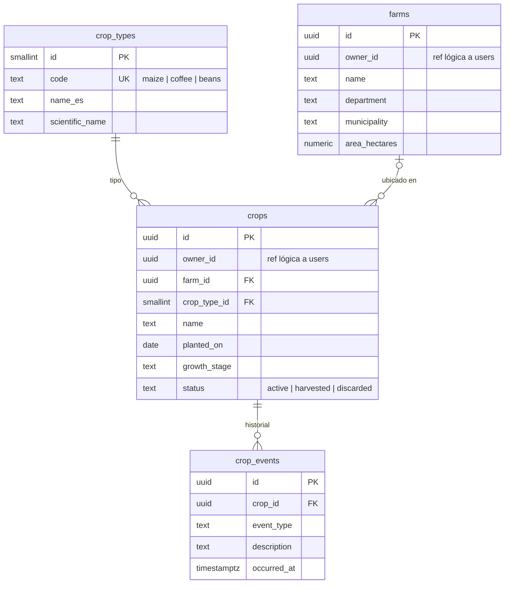
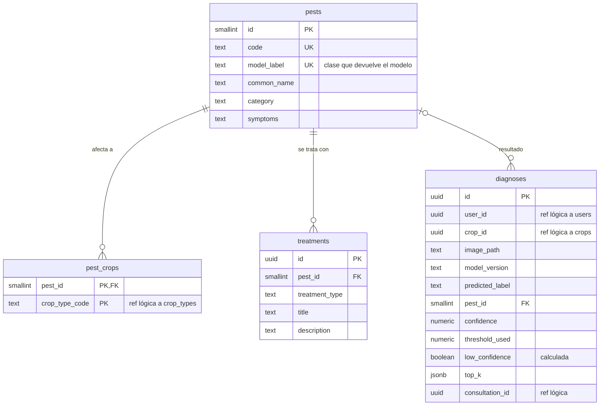
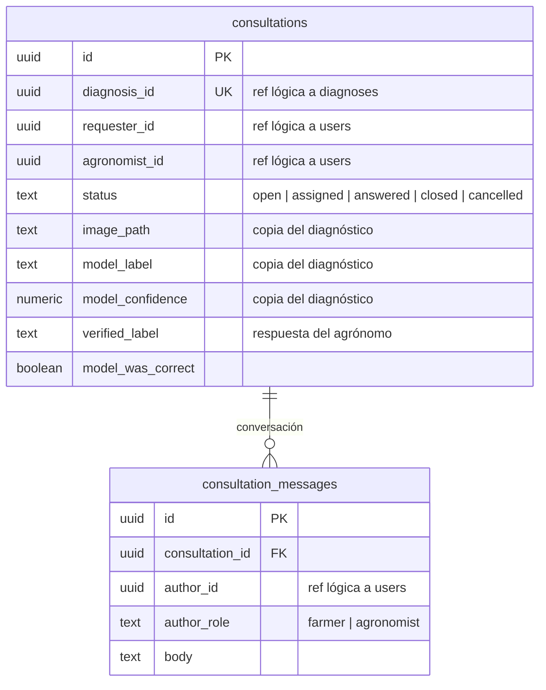
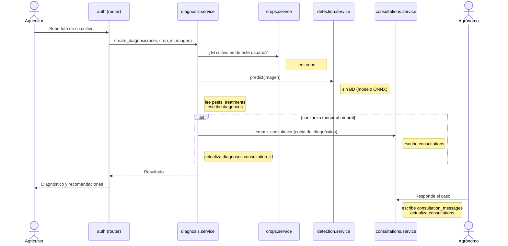

# Base de datos de AgroDoc

Diseño de la base de datos del monolito: qué tablas existen, **qué módulo es dueño de cada una** y cómo se relacionan.

La fuente de verdad del esquema son las migraciones de Alembic (`Backend/alembic/versions/`), que se aplican con `./scripts/migrate.sh`.

## 1. Una sola base de datos

**Decisión: un servidor Postgres con una única base, `agrodoc_db`.**

Al pasar de microservicios a un monolito modular se eliminaron las cuatro bases (`auth_db`, `crops_db`, `diagnosis_db`, `consultations_db`). La separación ya no se hace por base, sino por **propiedad de tablas**:

* Cada tabla tiene un módulo dueño.
* Solo el módulo dueño la lee y escribe.
* Los demás módulos piden datos a través del `service.py` del dueño, nunca con `SELECT` directo.

| | Varias bases (antes) | Una base, tablas por módulo (ahora) |
|---|---|---|
| Infraestructura | 4 bases que mantener | 1 base |
| Migraciones | 4 historias de Alembic | 1 historia de Alembic |
| Aislamiento | Físico (por base) | Lógico (por convención y revisión de código) |
| Integridad | Sin FK entre servicios | FK dentro del módulo; referencias lógicas entre módulos |
| Depuración | Varias conexiones y contenedores | Una conexión, `psql` directo |

La modularidad se mantiene en el código (vertical slicing), no en la infraestructura. Ver [`arquitectura.md`](./arquitectura.md).

## 2. Reglas

1. **Cada tabla tiene un solo módulo dueño.** Solo ese módulo la lee y escribe directamente.
2. **Prohibido que un módulo consulte tablas de otro.** Si `diagnosis` necesita saber si un cultivo es del usuario, llama a `crops.service`.
3. **FK dentro del módulo, referencia lógica entre módulos.** Dentro de un mismo módulo se usan `FOREIGN KEY` reales. Entre módulos se guarda un `uuid` sin FK (marcado como `ref lógica`) para no acoplar los esquemas.
4. **IDs `uuid`** generados por la base (`gen_random_uuid()`), así se pueden compartir entre módulos sin colisiones. Los catálogos pequeños usan `smallserial` más un `code` estable.
5. **Fechas en `timestamptz`** y `updated_at` automático mediante trigger.
6. **No se borran usuarios**: se desactivan (`users.is_active = false`), porque otros módulos guardan su `id`.

## 3. Vista general: qué módulo usa qué tablas



## 4. Tablas por módulo

| Módulo | Tablas | Contenido |
|---|---|---|
| `auth` | `users`, `agronomist_profiles`, `refresh_tokens` | Cuentas, perfiles de agrónomo y sesiones |
| `crops` | `crop_types`, `farms`, `crops`, `crop_events` | Catálogo de cultivos, fincas, cultivos e historial |
| `diagnosis` | `pests`, `pest_crops`, `treatments`, `diagnoses` | Catálogo de plagas, tratamientos y resultados |
| `consultations` | `consultations`, `consultation_messages` | Casos escalados y conversación |
| `detection` | — | Solo inferencia |

## 5. Referencias lógicas entre módulos

Cada flecha punteada es una columna `uuid` que apunta a una tabla de otro módulo **sin** `FOREIGN KEY`. La validación se hace en el `service.py` del módulo dueño.

```mermaid
flowchart LR
    subgraph auth[tablas de auth]
        users
    end
    subgraph crops[tablas de crops]
        farms
        crops
        crop_types
    end
    subgraph diagnosis[tablas de diagnosis]
        diagnoses
        pest_crops
    end
    subgraph consultations[tablas de consultations]
        consultations
        consultation_messages
    end

    farms -. owner_id .-> users
    crops -. owner_id .-> users
    diagnoses -. user_id .-> users
    diagnoses -. "crop_id" .-> crops
    diagnoses -. "crop_type_code" .-> crop_types
    pest_crops -. "crop_type_code" .-> crop_types
    diagnoses -. consultation_id .-> consultations
    consultations -. diagnosis_id .-> diagnoses
    consultations -. "requester_id / agronomist_id" .-> users
    consultations -. crop_id .-> crops
    consultation_messages -. author_id .-> users
```

## 6. Diagramas por módulo

### Módulo auth



### Módulo crops



### Módulo diagnosis



### Módulo consultations



## 7. Quién usa cada tabla

**Dueño** = único módulo que la lee y escribe. **Consumidores** = módulos que necesitan sus datos y los obtienen llamando al `service.py` del dueño.

| Tabla | Dueño | Consumidores (vía `service.py`) | Para qué |
|---|---|---|---|
| `users` | `auth` | `crops`, `diagnosis`, `consultations` | Cuentas y roles |
| `agronomist_profiles` | `auth` | `consultations` | Elegir agrónomo disponible |
| `refresh_tokens` | `auth` | — | Renovar sesión |
| `crop_types` | `crops` | `diagnosis` | Catálogo: maíz, café, frijol |
| `farms` | `crops` | — | Fincas del usuario |
| `crops` | `crops` | `diagnosis`, `consultations` | Cultivos guardados y contexto del caso |
| `crop_events` | `crops` | — | Bitácora del cultivo |
| `pests` | `diagnosis` | `consultations` | Catálogo de plagas |
| `pest_crops` | `diagnosis` | — | Qué plaga afecta a qué cultivo |
| `treatments` | `diagnosis` | — | Recomendaciones por plaga |
| `diagnoses` | `diagnosis` | `consultations` | Detalle del caso |
| `consultations` | `consultations` | `diagnosis` | Estado del caso escalado |
| `consultation_messages` | `consultations` | — | Conversación agricultor ↔ agrónomo |

## 8. Qué tablas se tocan en cada paso

Flujo de un diagnóstico con baja confianza:



Todas las llamadas son funciones del mismo proceso. No hay HTTP interno ni transacciones distribuidas.

## 9. Detalles de diseño

* **`diagnoses.low_confidence` es una columna calculada** (`confidence < threshold_used`), así nunca se contradice con la confianza guardada. El umbral se configura en `CONFIDENCE_THRESHOLD` y se guarda en cada fila para saber con cuál se decidió.
* **`diagnoses.top_k`** guarda las mejores predicciones alternativas del modelo en JSON: `[{"label": "...", "confidence": 0.12}]`.
* **`consultations` guarda una copia** de la imagen, la etiqueta y la confianza del modelo. Así el agrónomo ve el caso completo sin depender de `diagnosis` en cada lectura.
* **Reentrenamiento:** cuando el agrónomo responde, `verified_label` y `model_was_correct` quedan como etiqueta verificada por un experto. Es una fuente de datos reales de la región para el fine-tuning del modelo.
* **`pests.model_label`** es la clase exacta que devuelve el modelo. Tiene que coincidir con la lista de clases del entrenamiento (`ml/`); si se agregan o renombran clases, hay que actualizar el catálogo.
* **`crop_types.code`** (`maize`, `coffee`, `beans`) es la clave estable que usan los demás módulos en vez del `id` numérico.

## 10. Pendientes y decisiones abiertas

- [ ] **Modelos SQLAlchemy:** `models.py` de cada módulo está vacío; hay que implementar las tablas de este documento y generar la migración inicial con `./scripts/migrate.sh -m "esquema inicial"`.
- [ ] **Almacenamiento de imágenes:** las tablas guardan `image_path`, pero aún no hay dónde se guardan los archivos (volumen de Docker compartido, MinIO/S3, etc.). Hay que decidirlo y agregarlo al compose.
- [ ] **Datos iniciales (seed):** `crop_types` debe venir con maíz, café y frijol; `pests`, `pest_crops` y `treatments` deben llenarse con las plagas del modelo y sus tratamientos, idealmente revisados por un agrónomo.
- [ ] **Umbral de confianza:** definir el valor inicial (por defecto 0.70) y dónde se configura. Ya existe `CONFIDENCE_THRESHOLD` en `docker-compose.yml`.
- [ ] **Índices:** agregar índices a `diagnoses.user_id`, `diagnoses.crop_id` y `consultations.status` cuando existan consultas reales.

## 11. Cómo revisar el esquema

Con el entorno levantado (`./scripts/dev.sh`):

```bash
./scripts/migrate.sh              # aplica todas las migraciones
```

Para entrar a la base:

```bash
docker compose -f infra/docker-compose.yml --env-file .env exec postgres \
  psql -U agrodoc -d agrodoc_db -c '\dt'
```

(cambia `agrodoc` por el valor de `POSTGRES_USER` en tu `.env`).

Para empezar de cero: `./scripts/reset-db.sh` y luego `./scripts/migrate.sh`.
